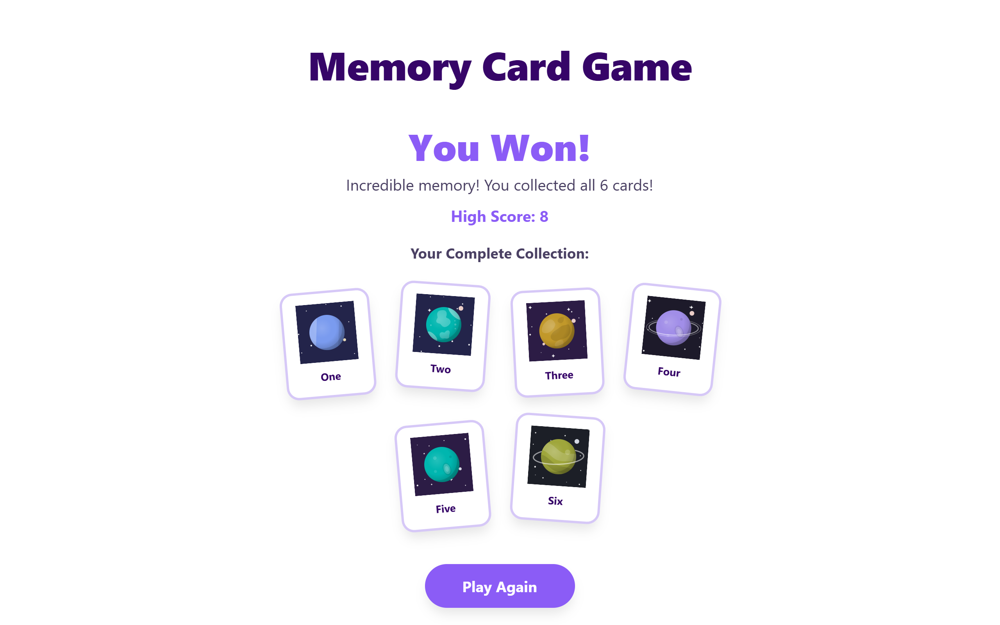

# 🪐 Kids' Memory Card Game (React)

A child-friendly memory card game built with React, featuring a chunky "sticker" aesthetic, dynamic layout management, interactive themes, and persistent high scores.



---

## 🎮 Game Features & Aesthetics

- **Themes:** Powered by DiceBear avatars (`planets` and `clay`).
- **Difficulty Levels:** Choose between **Easy**, **Medium**, and **Hard** game modes.
- **Score Tracking & Persistence:** Live score updates displayed in the top header badge, backed by `localStorage` persistence for your **High Score**.
- **Collection Gallery:** Win or lose, view your complete set of collected stickers laid out in a card board summary.

---

## 💡 Technical Highlights

- **CSS-Only Sticker Rotations:** Uses structural pseudo-classes (`:nth-child(4n + 1)`, etc.) and CSS transforms to give the collected item gallery a scattered, organic sticker-book look without external libraries.
- **Dynamic CSS Clamp Layouts:** Fluid typography, spacing, and image scaling driven entirely by `clamp()` to ensure seamless scaling from mobile to desktop.
- **Centralized State Machine:** Manages game transitions (`SETUP`, `PLAYING`, `WIN`, `GAME_OVER`) cleanly inside `App.jsx` with persistent high-score tracking via a lightweight `localStorage` utility.

---

## 🛠️ Getting Started

### 1. Clone the repository:

```Bash
git clone [https://github.com/your-username/memory-card-game.git](https://github.com/your-username/memory-card-game.git)
```

### 2. Open project directory:

```bash
cd memory-card-game
```

### 3.Install dependencies:

```Bash
npm install
```

### 4. Start the development server:

```Bash
npm run dev
```

---

## 📜 Credits & License

- Avatars: Generated using DiceBear.

- Clay Theme: Clay by DiceBear, licensed under CC0 1.0.
